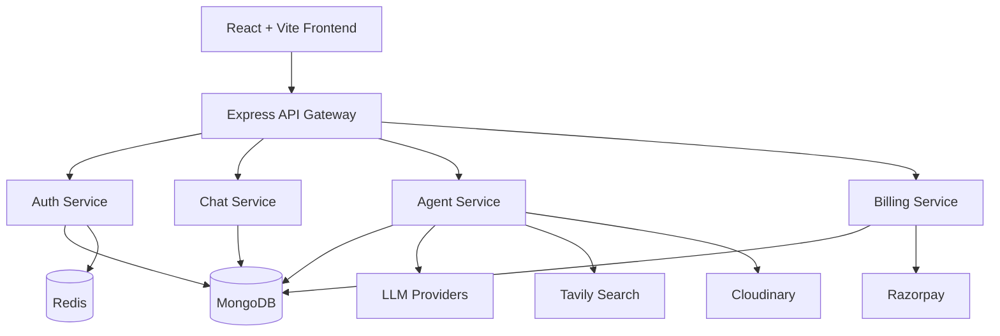

<div align="center">

# NexusAI

### Your AI workspace for chat, research, code, and document creation.

An AI-powered multi-agent assistant built with the MERN stack and a microservices architecture.

[](https://nexus-ai-navy-mu.vercel.app)
[](https://github.com/AryanBhatare07/NexusAI)

</div>

---

## Overview

**NexusAI** is a full-stack AI assistant designed to bring multiple AI capabilities into one workspace. Instead of relying on a single response flow, it routes user requests to specialised workflows based on the task.

You can use NexusAI for everyday conversations, web research, coding assistance, and document-related tasks—all through a single chat interface.

The application uses a React frontend and a Node.js/Express backend split into independent services. It also integrates external AI providers and supporting services for authentication, storage, and session management.

## Features

- **AI Chat:** Have contextual conversations through a clean chat interface.
- **Intent-Based Routing:** Routes requests to specialised workflows such as chat, web search, coding, PDF, presentation, and vision tasks.
- **Web Research:** Retrieve information from the web using Tavily-powered search.
- **Coding Assistant:** Generate, explain, review, and debug code.
- **Code Artifacts:** View generated code in a dedicated artifact panel.
- **Document Workflows:** Work with uploaded files and generate PDF or presentation outputs.
- **Google Authentication:** Sign in using Firebase Authentication.
- **Conversation History:** Save, retrieve, and manage previous conversations.
- **Microservices Backend:** Separate services for authentication, chat, agent workflows, and billing.
- **Session Management:** Cookie-based sessions with Redis.
- **Responsive Interface:** Chat workspace designed for desktop and mobile screens.
- **Credits and Payments:** Credit-based usage and Razorpay integration.

## Live Application

| Component        | URL                                                                                    |
| ---------------- | -------------------------------------------------------------------------------------- |
| NexusAI Frontend | [https://nexus-ai-navy-mu.vercel.app](https://nexus-ai-navy-mu.vercel.app)             |
| API Gateway      | [https://nexusai-gateway-zshb.onrender.com](https://nexusai-gateway-zshb.onrender.com) |

> **Note:** Backend services are hosted on Render's free tier. The first request after a period of inactivity may take longer while a service starts.

## Tech Stack

| Category             | Technologies                          |
| -------------------- | ------------------------------------- |
| Frontend             | React, Vite, JavaScript, Tailwind CSS |
| State Management     | Redux Toolkit                         |
| Backend              | Node.js, Express.js                   |
| Database             | MongoDB, Mongoose                     |
| Authentication       | Firebase Authentication               |
| Session Storage      | Redis                                 |
| AI Orchestration     | LangGraph                             |
| AI Providers         | Groq, OpenRouter, Google Gemini       |
| Web Search           | Tavily                                |
| File & Image Storage | Cloudinary                            |
| Payments             | Razorpay                              |
| Deployment           | Vercel, Render                        |

## Architecture

NexusAI follows a microservices-based backend architecture. The frontend communicates with the API Gateway, which forwards requests to the appropriate service.



### Backend Services

| Service         | Responsibility                                                         |
| --------------- | ---------------------------------------------------------------------- |
| API Gateway     | Central entry point, request routing, and protected service access     |
| Auth Service    | Firebase token verification, user authentication, and session handling |
| Chat Service    | Conversation and message management                                    |
| Agent Service   | Intent routing and specialised AI workflows                            |
| Billing Service | Credits and payment-related operations                                 |

## Project Structure

```text
NexusAI/
├── client/
│   ├── public/
│   └── src/
│       ├── app/
│       ├── components/
│       ├── features/
│       └── ...
│
├── server/
│   ├── gateway/
│   ├── services/
│   │   ├── auth/
│   │   ├── chat/
│   │   ├── agent/
│   │   └── billing/
│   └── shared/
│       └── redis/
│
└── README.md
```

_The frontend and service folders may contain additional modules and configuration files._

## Getting Started

Follow these steps to run NexusAI locally.

### Prerequisites

Make sure you have the following installed:

- [Node.js](https://nodejs.org/) (LTS recommended)
- npm
- [MongoDB](https://www.mongodb.com/)
- [Redis](https://redis.io/)
- Git

You will also need credentials for the external services you want to use, such as Firebase, an AI provider, Tavily, and Cloudinary.

### 1. Clone the repository

```bash
git clone https://github.com/AryanBhatare07/NexusAI.git
cd NexusAI
```

### 2. Install frontend dependencies

```bash
cd client
npm install
```

Create a `.env` file inside `client/` and configure the required frontend variables:

```env
VITE_SERVER_URL=http://localhost:8000
VITE_FIREBASE_API_KEY=your_firebase_api_key
VITE_RAZORPAY_KEY_ID=your_razorpay_key_id
```

Use the exact variable names referenced by your frontend configuration. Add any other Firebase configuration values required by your setup.

### 3. Install backend dependencies

Open a terminal at the repository root and install dependencies for the gateway and each service:

```bash
cd server
npm install --prefix gateway
npm install --prefix services/auth
npm install --prefix services/chat
npm install --prefix services/agent
npm install --prefix services/billing
```

Create the environment files required by each service. Configure the values used by your service code; common integrations include:

```env
# Database
MONGO_URI=your_mongodb_connection_string

# Redis
REDIS_URL=your_redis_connection_url

# AI providers
GROQ_API_KEY=your_groq_api_key
OPENROUTER_API_KEY=your_openrouter_api_key
GOOGLE_API_KEY=your_google_api_key

# Web search
TAVILY_API_KEY=your_tavily_api_key

# File storage
CLOUDINARY_CLOUD_NAME=your_cloudinary_cloud_name
CLOUDINARY_API_KEY=your_cloudinary_api_key
CLOUDINARY_API_SECRET=your_cloudinary_api_secret

# Frontend origin used by the gateway
CLIENT_URL=http://localhost:5173
```

Also configure the service URLs used by the API Gateway:

```env
AUTH_SERVICE=http://localhost:8001
CHAT_SERVICE=http://localhost:8002
AGENT_SERVICE=http://localhost:8003
BILLING_SERVICE=http://localhost:8004
```

> Environment variable names and locations must match the configuration files in each service. Add Firebase Admin credentials and Razorpay credentials wherever those integrations are configured. Never commit `.env` files, private keys, or service-account JSON files.

### 4. Start the backend services

Run each service in a separate terminal from the repository root. If your local port configuration differs, update the service URLs in the gateway environment.

```bash
# Terminal 1 — API Gateway
cd server
node gateway/index.js
```

```bash
# Terminal 2 — Auth Service
cd server
node services/auth/index.js
```

```bash
# Terminal 3 — Chat Service
cd server
node services/chat/index.js
```

```bash
# Terminal 4 — Agent Service
cd server
node services/agent/index.js
```

```bash
# Terminal 5 — Billing Service
cd server
node services/billing/index.js
```

### 5. Start the frontend

```bash
cd client
npm run dev
```

Open the local Vite URL shown in your terminal (usually `http://localhost:5173`).

## Environment & Security

- Keep API keys and credentials in environment variables.
- Do not expose private API keys in frontend code.
- Do not commit `.env` files, Firebase service-account files, or private credentials.
- Configure Firebase authorized domains and authentication settings for your local and deployed frontend URLs.
- Set the production `CLIENT_URL` to the exact frontend origin.
- Use HTTPS and secure cookie settings in production.

## Deployment

The current deployment uses:

- **Frontend:** Vercel
- **Backend services:** Render

For your own deployment, configure the frontend build settings for the `client` directory and deploy each backend service with its corresponding root directory, build command, start command, and environment variables.

## Future Improvements

- Expand specialised agent workflows and tool integrations.
- Improve response streaming and task progress feedback.
- Add more file formats and document workflows.
- Add automated tests and CI checks.
- Improve observability and service-level error handling.

## Author

**Aryan Bhatare**

- GitHub: [@AryanBhatare07](https://github.com/AryanBhatare07)

---

<div align="center">

**Built with curiosity and a lot of code.**

If you find NexusAI interesting, consider giving the repository a ⭐.

</div>
